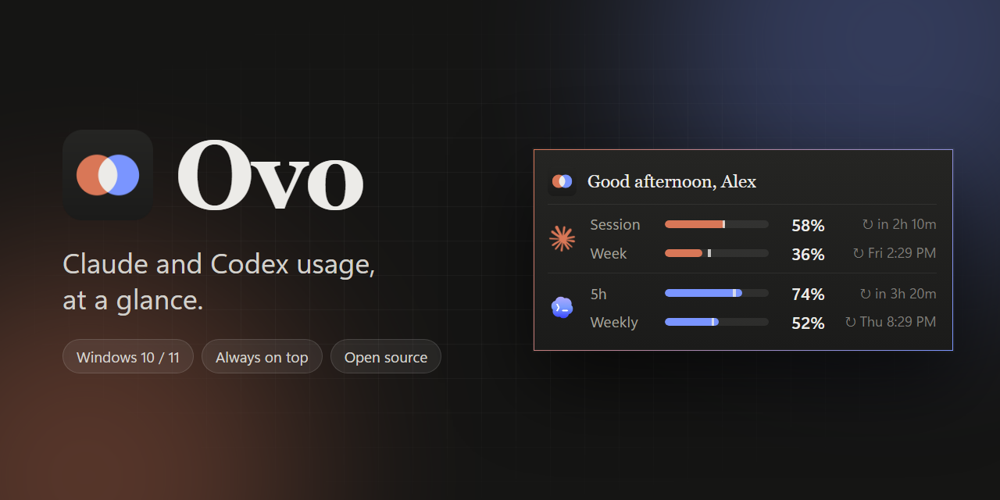
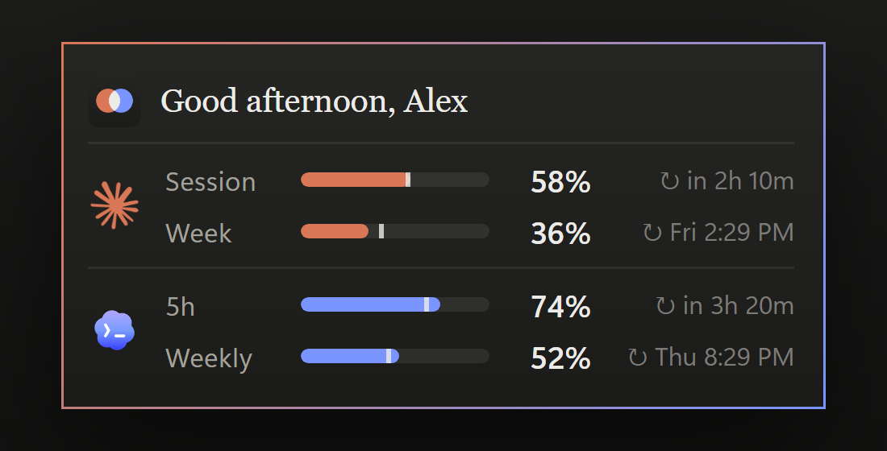

<p align="center"></p>

<p align="center">
  <a href="LICENSE"></a>
  
  
  <a href="https://github.com/1iiron/ovo/releases"></a>
</p>

<p align="center">
  <b>Ovo</b> is one small always-on-top window that keeps your <b>Claude</b> and <b>Codex</b> limits in view,<br>
  so you never open a settings page to find out how much you have left.
</p>

<p align="center">
  <a href="#install">Install</a> ·
  <a href="#features">Features</a> ·
  <a href="#reading-the-window">Reading the window</a> ·
  <a href="#settings">Settings</a> ·
  <a href="#how-it-works">How it works</a> ·
  <a href="#faq">FAQ</a> ·
  <a href="#contributing">Contributing</a>
</p>

<p align="center"></p>

<!-- latest-release:start -->
**Latest release: [Ovo 1.0.0](https://github.com/1iiron/ovo/releases/tag/v1.0.0)** · 2026-11-02 · [Download for Windows](https://github.com/1iiron/ovo/releases/download/v1.0.0/Ovo-1.0.0-windows.zip)

First release.

- One small always-on-top window with your Claude and Codex usage, refreshed every 3 seconds.
- A setup screen on first run: your name, what you use, and a few options.
- Pace marker on each bar, and alerts at 80% and 90% and when a limit resets.
- Hides while a full-screen app is running. Optional start with Windows.
- Update checks: when a new version is published Ovo tells you and asks before installing anything.
- Runs fully on your PC: no server, and requests only to claude.ai, chatgpt.com and github.com.
<!-- latest-release:end -->

## Features

| | |
|---|---|
| **Both in one window** | Claude and Codex side by side, with one taskbar button. Use one or both. |
| **Live numbers** | Refreshed every 3 seconds, the same numbers the services show you. |
| **Pace marker** | A tick on each bar shows how far through its window you are, so you can see if you're running ahead of the reset. |
| **Alerts** | An amber message at 80%, red at 90%, and green when a limit resets. Windows notifications too. |
| **Stays out of the way** | Hides while a game, video or presentation is full-screen, and comes back after. |
| **Starts with Windows** | Optional. |
| **Updates itself, if you say so** | Tells you when a new version is out and asks before installing it. |
| **Private** | Your numbers go from the services to your screen and nowhere else. No account, no telemetry. |

## Install

Ovo needs **Windows 10 or 11**.

### Option 1: the app (no Python needed)

1. Download <!-- zip:start -->[Ovo-1.0.0-windows.zip](https://github.com/1iiron/ovo/releases/download/v1.0.0/Ovo-1.0.0-windows.zip)<!-- zip:end --> from the [Releases](https://github.com/1iiron/ovo/releases) page and unzip it.
2. Run `Ovo.exe`. The setup screen opens.
3. Optional: run `Ovo.exe install` once from a terminal to add an "Ovo" shortcut to the Start Menu.

Windows SmartScreen may warn you the first time, because the app isn't code-signed. Choose **More info**, then **Run anyway**.

### Option 2: from source

You need Python 3.11 or newer.

```bash
git clone https://github.com/1iiron/ovo.git
cd ovo
pip install -r requirements.txt
python ovo.pyw
```

Run `python ovo.pyw install` to add the Start Menu shortcut.

### First run

A setup screen asks for:

- **Your name**, used in the greeting.
- **What you use**: Claude, Codex, or both. Ovo shows only what you use.
- Three options: start with Windows, alerts, and hide in full-screen.

If you use Claude, a small sign-in window for claude.ai opens once. Sign in, and Ovo keeps you signed in. Codex needs no sign-in: Ovo uses the login the Codex app already has on your PC.

## Reading the window

<table>
<tr><td><b>Claude</b></td><td>Session and Week, shown as how much you have <i>used</i>, like claude.ai's usage page.</td></tr>
<tr><td><b>Codex</b></td><td>5h and Weekly, shown as how much is <i>left</i>, like the Codex usage menu.</td></tr>
<tr><td><b>Bar colour</b></td><td>The provider's colour, turning amber at 70% used and red at 90% used.</td></tr>
<tr><td><b>Tick on a bar</b></td><td>The pace marker: how far through the window you are. On a Claude bar, a bar past the tick means you're using it faster than it resets. On a Codex bar (which shows what's left), a bar short of the tick means the same. Hover a row for the numbers.</td></tr>
<tr><td><b>↻ in 2h 10m</b></td><td>Time until the reset. Hover the window to see the clock time instead.</td></tr>
<tr><td><b>Dimmed, amber dot</b></td><td>That service isn't answering. Its last numbers stay on screen; hover for when they were updated. The other one keeps updating.</td></tr>
</table>

## Settings

Right-click Ovo for the menu:

| | |
|---|---|
| **Refresh now** | Check immediately. |
| **Reset position** | Move Ovo back to the bottom-right corner. |
| **Settings…** | Change your name, what you use, or the options (start with Windows, alerts, hide in full-screen, update checks). Ovo restarts to apply them. It also has a **Check for updates** link. |
| **Quit** | Close Ovo. |

Drag the window to move it. Ovo remembers where you put it.

## Updates

Ovo checks GitHub for a new version when it starts and every few hours. When one is out, the greeting is replaced by "Ovo 1.1.0 is available" with two buttons:

- **Update**: the app downloads the new version, checks it against its published checksum, swaps itself and restarts. If you run Ovo from source, it opens the release page instead.
- **Later**: Ovo asks again tomorrow.

Nothing is ever installed unless you press **Update**. Turn the check off, or check right now, under **Settings…**.

## How it works

Ovo calls the same usage endpoints the services' own apps use.

- **Claude:** a hidden browser window (WebView2) holds your claude.ai login and reads your usage from there. claude.ai blocks plain scripts, so it has to be a real browser.
- **Codex:** reads the access token in `~/.codex/auth.json` and asks ChatGPT for your rate limits. It only reads that file. It never changes it or copies the token anywhere.

Your settings, Claude login and window position live in the `data/` folder next to the script (or `%APPDATA%\Ovo` for the packaged app). Don't share that folder.

### Safe by design

- **Local only.** Ovo opens no port and no server. Nothing can connect to it.
- **Three destinations.** It talks only to claude.ai and chatgpt.com (your numbers) and github.com (the update check, which you can turn off) over HTTPS. No telemetry.
- **Your Codex login is only read**, sent only to chatgpt.com, and the request never follows a redirect.
- **Replies are checked** before use and shown as plain text, never as code.
- **Its windows can't call out.** Ovo's pages carry a policy that lets them load nothing from the network.

The full list, and what it can't protect against, is in [SECURITY.md](SECURITY.md).

<details>
<summary><b>What Ovo changes on your PC</b></summary>

- The files above.
- If you turn on **Start with Windows**: one value named `Ovo` under your own account's `Run` key. Turning the option off removes it.
- If you run `install`: a shortcut at `%APPDATA%\Microsoft\Windows\Start Menu\Programs\Ovo.lnk`.
- Alerts show a Windows notification from a temporary tray icon that disappears afterwards.

Nothing else. Ovo talks only to claude.ai and chatgpt.com, plus github.com for the update check.
</details>

## FAQ

<details>
<summary><b>Codex says "login expired"</b></summary>

The Codex app renews its login whenever you use it. After about 10 days without opening Codex the login expires. Open Codex once and Ovo picks up the new one.
</details>

<details>
<summary><b>I don't see Windows notifications</b></summary>

Windows may be holding them back, for example in Do Not Disturb, or with notifications turned off. Check Settings → System → Notifications. Either way, alerts also appear inside Ovo's own window, so you won't miss them.
</details>

<details>
<summary><b>Windows SmartScreen or my antivirus warns about Ovo.exe</b></summary>

The packaged app isn't code-signed (a certificate costs money), and some tools distrust unsigned apps built this way. You can read all of `ovo.pyw` and build the exe yourself with `python tools/build.py`.
</details>

<details>
<summary><b>Ovo disappeared while I was gaming</b></summary>

That's the "hide while a full-screen app is running" option. It comes back when you leave full-screen. Turn it off under Settings…
</details>

<details>
<summary><b>How do I remove Ovo?</b></summary>

Untick **Start with Windows** in Settings…, quit Ovo, then delete its folder (and `%APPDATA%\Ovo` for the packaged app) and the Start Menu shortcut if you made one.
</details>

<details>
<summary><b>Why are the corners square?</b></summary>

Windows 11 only rounds a window's corners if it also draws a drop shadow, and Ovo is deliberately shadow-free.
</details>

<details>
<summary><b>It stopped working after a service changed something</b></summary>

These are internal endpoints, not public APIs, so they can change without notice. Please [open an issue](https://github.com/1iiron/ovo/issues) and say what you see.
</details>

## Build the app yourself

```bash
pip install pyinstaller pillow
python tools/build.py        # dist/Ovo.exe and dist/Ovo-<version>-windows.zip
python tools/make_media.py   # re-renders docs/banner.png and docs/screenshot.png (needs Microsoft Edge)
python tools/make_assets.py  # rebuilds the icon files in assets/
```

## Contributing

Bug reports and pull requests are welcome. See [CONTRIBUTING.md](CONTRIBUTING.md). To report a security problem, see [SECURITY.md](SECURITY.md).

The look and feel (name, colours, logo) is written down in [docs/brand.md](docs/brand.md).

## License

[MIT](LICENSE). Free to use, change and share.

## Disclaimer

Ovo is an independent project. It is not affiliated with, endorsed by, or sponsored by Anthropic or OpenAI. "Claude" and "Codex" and their logos belong to their owners and are used here only to label each service.
